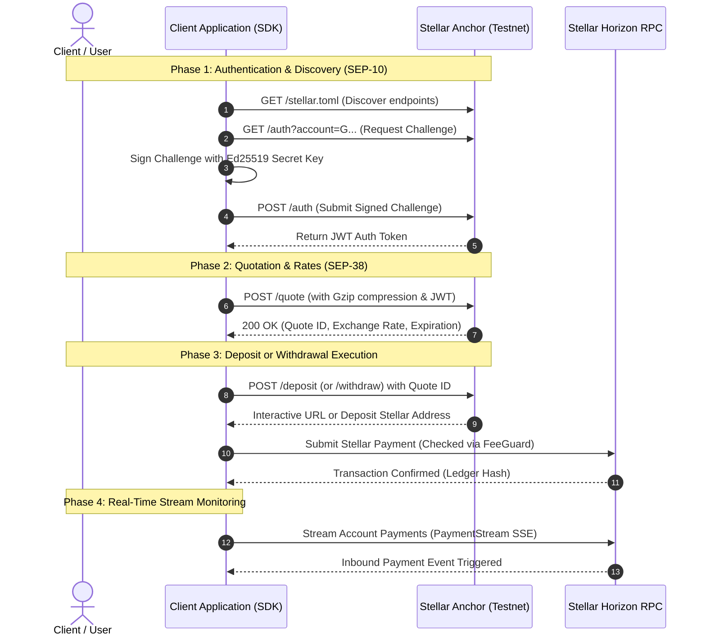

# Anchor Integration Developer Guide: End-to-End Flows

## 1. Overview & Architecture

This guide details how to integrate `payments-sdk-wrapper` with live Stellar Testnet Anchor services (supporting SEP-10, SEP-38, and SEP-24/SEP-6 deposit and withdrawal standards). 

The SDK streamlines interactions with Stellar anchors by combining:
- **`PaymentClient`**: Core orchestrator connecting to Horizon RPC and enforcing transaction guardrails.
- **`Sep38Client`**: Anchor quotation engine supporting bandwidth-efficient gzip compression.
- **`FeeGuardEngine`**: Real-time fee guard protecting against network fee spikes.
- **`PaymentStream`**: High-resilience Server-Sent Events (SSE) payment listener.

---

## 2. End-to-End Integration Flow



---

## 3. Step-by-Step Code Walkthrough

### 3.1 Initializing the Client

```typescript
import { PaymentClient, Sep38Client } from 'payments-sdk-wrapper';

// Initialize the primary payment client bound to Testnet Horizon
const client = new PaymentClient({
  network: 'testnet',
  horizonUrl: 'https://horizon-testnet.stellar.org',
  maxFeeStroops: 100000, // Maximum 0.01 XLM allowed fee
  anchorUrl: 'https://anchor-testnet.stellar.org',
});
```

### 3.2 Requesting Anchor Quotes (SEP-38) with Gzip

```typescript
// Query anchor quotation with automatic gzip compression
const quote = await client.sep38.getQuote(
  {
    sellAsset: 'iso4217:USD',
    buyAsset: 'stellar:USDC:GA5ZDFLYAV3TDOBECTV7TQWWMXHJ3ZN6R4QUO2GQ2EWVIKPKEB4Q54ZR',
    sellAmount: '100.00',
    context: 'sep6',
  },
  jwtAuthToken // Obtained from SEP-10 authentication
);

console.log(`Quote Received: ID ${quote.id}`);
console.log(`Rate: ${quote.price} (Expires at: ${quote.expires_at})`);
```

### 3.3 Submitting Payments with FeeGuard

```typescript
import { Keypair, Operation, Asset, TransactionBuilder, Account } from '@stellar/stellar-sdk';

const senderKp = Keypair.fromSecret('S...');
const account = await client.server.loadAccount(senderKp.publicKey());

// Construct the payment transaction
const transaction = new TransactionBuilder(account, {
  fee: '100',
  networkPassphrase: 'Test SDF Network ; September 2015',
})
  .addOperation(
    Operation.payment({
      destination: quoteDepositAddress,
      asset: Asset.native(),
      amount: '50.0',
    })
  )
  .setTimeout(180)
  .build();

// Sign and submit through PaymentClient (validates maxFeeStroops)
transaction.sign(senderKp);
const result = await client.submitTransaction(transaction);
console.log('Transaction Success:', result.hash);
```

### 3.4 Streaming Inbound Payments

```typescript
// Stream real-time payment notifications via Server-Sent Events (SSE)
const stream = client.createStream({
  account: senderKp.publicKey(),
  cursor: 'now',
});

stream.on('payment', (event) => {
  console.log(`Received ${event.amount} ${event.asset_code} from ${event.from}`);
});

stream.on('error', (err) => {
  console.error('Stream error:', err);
});
```

---

## 4. Production Security Best Practices

1. **Keep Secrets Off-Chain**: Never hardcode secret keys; utilize environment variables (`process.env.STELLAR_SECRET`) or hardware wallets.
2. **Fee Guarding**: Always configure `maxFeeStroops` to prevent wallet depletion during network fee surges.
3. **Payload Compression**: Maintain `enableGzip: true` for high-throughput batch quote requests to minimize mobile and edge bandwidth overhead.
